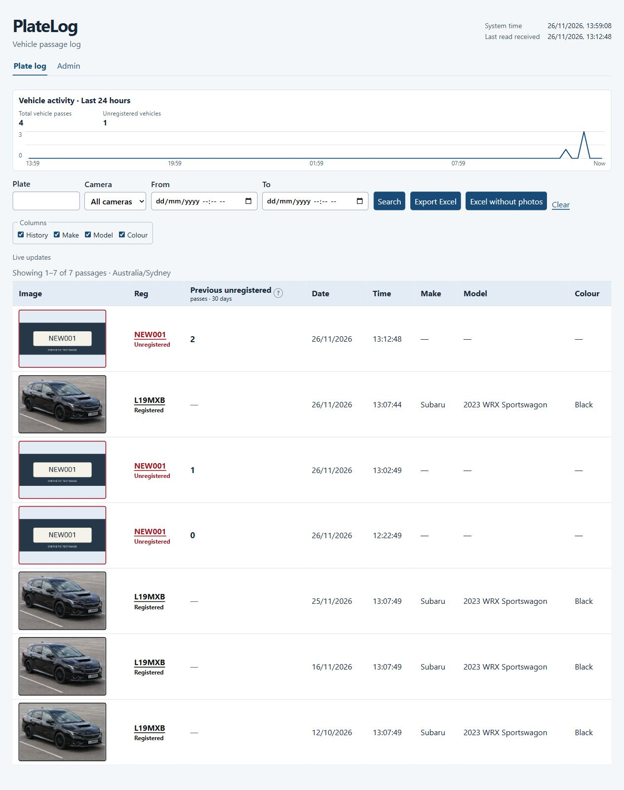
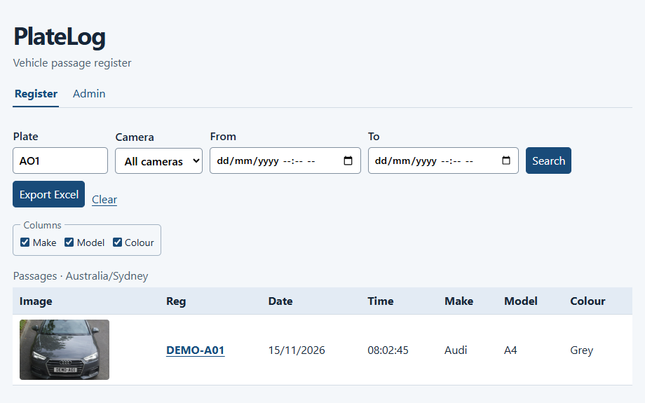

# PlateLog

PlateLog is a prototype for a local Axis licence plate log. A persistent instance receives Axis HTTP POST events and provides live plate search, vehicle photos, Excel exports and scheduled CSV reports. The [technical design notes](technical-spec.md) describe the architecture and proposed features.

## Offline Windows Server pilot

**[IT quick start](IT-COMMANDS.md)** has the server setup block, staff PC check and Admin password reset.

**Security review:** [SOC 2 readiness assessment — 26 November 2026](docs/SOC2-READINESS.md) · [Windows hardening guide](docs/HARDENING.md). Review the open site acceptance gates before live capture.

Tested on **Windows Server 2025** with **CPython 3.15.2 x64** and **SQLite 3.53.4**. The offline ZIP includes Python source, local wheels, a hash-locked requirements file and the deployment guide. [SQLite WAL advisory](https://sqlite.org/wal.html#the_wal_reset_bug)

- **Staff and Admin** use HTTPS on **TCP 443** by default. Set an alternate staff port with `--port` if IT requires one.
- **Cameras** use HTTPS on **TCP 8766** when enabled. Follow the [single-camera setup](IT-COMMANDS.md#connect-one-camera).

### Workstation certificate trust

Use the site's managed certificate policy. Run the [staff PC check](IT-COMMANDS.md#2-check-from-a-staff-pc) before handing over the link.

### Offline troubleshooting

Open **Admin → Diagnostics**, choose **Last 24 hours**, **Last 2 days**, **Last 3 days** or **All available history**, then select **Download diagnostics ZIP**. Copy the ZIP through the site's approved USB or file-transfer process for support. Nothing is uploaded automatically.

The bundle includes runtime versions, safe configuration summaries, event counts, job outcomes and structured errors with code locations. It excludes passwords, number plates, photos, raw payloads, addresses and file paths. Detailed logs start with this version and retain up to **30 days or 8 MiB**, whichever is reached first. **All** includes available retained history; the bundle reports unreadable or limited input. If the web page cannot start, use the [offline diagnostics command](IT-COMMANDS.md#download-diagnostics).

## Quick start

The browser demo uses simulated captures to show vehicle photos, live plate search, date and time filters, Excel export with photos, and password-protected application settings.



Typing filters the plate log after every keystroke. This synthetic example searches for `L19` and shows the registered `L19MXB` vehicle.



One of the simulated camera captures features `L19MXB`, a nod to PlateLog’s creator.


With Python 3.12 or 3.13 installed, run the following from the repository root, then open `http://127.0.0.1:8765/`:

```sh
python -m pip install -r requirements.txt
python -m platelog preview
```

## Run the demo

From this directory, with Python 3.12 or newer:

```sh
python -m pip install -r requirements.txt
python -m platelog demo
```

The demo starts a temporary HTTP server on `127.0.0.1`, sends simulated camera payloads, and shuts down. It uses two fictitious cameras, generated JPEGs marked as synthetic, and a temporary SQLite database. It exits with an error if any expected outcome fails.

| Case | Expected result |
| --- | --- |
| JSON with an embedded JPEG | The saved JPEG matches the original bytes and SHA-256. |
| Replay of the same packet | The receiver returns the original packet and passage IDs. |
| Plate correction arrives after the closing event | The entry shows `DEMO-A01`, direction `in`, three packets, and the original photo. The initial OCR text `DEMO-AO1` remains searchable. |
| A second camera sends multipart metadata and a JPEG | The exit shows `DEMO-B02`, direction `out`, and its own photo, even though both cameras use runtime ID `42`. |
| Unauthenticated photo request and invalid payload | The server returns HTTP `401` and `400` respectively. |

The simulator follows the documented Axis push fields. The multipart fixture represents a JSON part and a separate JPEG. A real payload from the candidate firmware is still needed to confirm wire compatibility, camera authentication, buffering and the passage correlation window. [Axis push event API](https://developer.axis.com/vapix/applications/license-plate-verifier-api/#push-events)

## Keep a local demo running

Set `PLATELOG_DEMO_TOKEN` to the same randomly generated value of at least 24 URL-safe characters in both terminals. Start the server in the first terminal:

```sh
python -m platelog serve
```

Send and verify the synthetic sequence in the second terminal:

```sh
python -m platelog simulate
```

Use the returned passage ID to read its history. For example, in PowerShell:

```powershell
$headers = @{ Authorization = "Bearer $env:PLATELOG_DEMO_TOKEN" }
Invoke-RestMethod -Headers $headers 'http://127.0.0.1:8765/api/passages?camera=demo-entry'
```

The server binds to loopback and stores this mode’s data in `.platelog-data/` by default. The temporary `demo` command is the quickest way to get a fresh run. For the storage and parser regression tests, run `python -m unittest discover -s tests -v`.

## Open the browser preview

Run `python -m platelog preview --timezone Australia/Sydney`, then open `http://127.0.0.1:8765/`. Type part of a registration to filter the list as you type. Enter `AO1` to find the corrected entry by its original OCR read. Click its thumbnail or registration to open the original photo and packet history. Use the Columns controls to hide or show Make, Model or Colour. The browser remembers these settings.

The register shows 50 passages per page, newest first. Page 1 updates automatically every five seconds with the current filters. Use the page links to browse older results and **Return to live** to resume automatic updates. The header shows the server clock and when PlateLog last saved a camera read, across all cameras. The clock uses the register's display time zone and the read time updates even while browsing older pages.

**Vehicle activity** updates every five seconds and plots vehicle passes in 15-minute intervals over the last 24 hours. **Total vehicle passes** counts each passage. **Unregistered vehicles** counts distinct plates absent from the current registered list. The camera dropdown applies to the chart. The chart retains its 24-hour window while you search or browse older passages. Register rows show **Registered** in black or **Unregistered** in red, with a matching photo border. Both the rows and the activity summary use the current registered list.

Set **From** and **To** to filter by the passage's first capture time in the displayed time zone. The selected **To** minute is included. Leave either bound blank to search without that limit. **Export Excel** downloads a summary with counts by camera and one row per matching passage across all pages, with a thumbnail before the registration. **Excel without photos** keeps the passage data and photo counts in a smaller workbook.

PlateLog prepares one Excel export at a time. Each workbook can include up to 10,000 passages. Exports with photos also have a limit of 5,000 thumbnails and 32 MiB of combined thumbnails. If a selection exceeds a limit, narrow **From** and **To** or switch to **Excel without photos** when offered. PlateLog returns a message in place of a partial workbook.

The browser preview uses a fresh database unless you specify `--data-dir`. The two JPEG fixtures are generated images of front-facing vehicles with fictitious plates. The simulator supplies make, model and colour. Missing fields appear as a dash. Axis documents colour in `vehicle_info`. Make and model require a source that supplies them. A Docker image can serve the same preview:

```sh
docker build -t platelog-preview .
docker run --rm --read-only --tmpfs /tmp:rw,noexec,nosuid,size=32m,mode=1777 -p 127.0.0.1:8765:8765 platelog-preview
```

For a LAN demo, publish `8765:8765` and pass `preview --host 0.0.0.0 --allowed-host SERVER_NAME` after the image name. Use the server hostname or IPv4 address in place of `SERVER_NAME`. Anyone who can reach the listener can view and export the sample register.

### Run Docker on an offline Linux server

On an internet-connected machine with Docker, build the image from this repository. Use the same CPU architecture as the destination server.

```sh
docker build -t platelog-preview:latest .
docker save -o platelog-preview.tar platelog-preview:latest
```

Transfer `platelog-preview.tar` to the offline Linux server using your approved file transfer process. With Docker already installed, run these commands from the folder containing the archive.

```sh
docker load -i platelog-preview.tar
docker run -d --name platelog --restart unless-stopped --pull=never \
  --read-only --tmpfs /tmp:rw,noexec,nosuid,size=32m,mode=1777 \
  -p 0.0.0.0:8765:8765 platelog-preview:latest \
  preview --host 0.0.0.0 --allowed-host '*'
```

From a desk that can reach TCP port `8765` on the server, open `http://SERVER-NAME:8765/` using the Linux server's hostname or IPv4 address. This setup recreates the synthetic register on restart.

For an empty, persistent instance with camera intake and Admin settings, load the same image archive and run the following on the Linux host. Use a separate container name or stop the temporary demo to free TCP `8765` first. The image runs as UID and GID `65532`.

```sh
sudo install -d -m 0750 -o 65532 -g 65532 "$PWD/platelog-data"
docker run -d --name platelog --restart unless-stopped --pull=never \
  --read-only --tmpfs /tmp:rw,noexec,nosuid,size=32m,mode=1777 \
  --mount "type=bind,source=$PWD/platelog-data,target=/data" \
  -p 0.0.0.0:8765:8765 -p 0.0.0.0:8766:8766 platelog-preview:latest \
  preview --host 0.0.0.0 --allowed-host '*' --data-dir /data --no-demo
```

Sign in to **Admin** on TCP `8765` with the initial password `admin`, then set a new password to unlock settings. Register each camera before sending events to TCP `8766`. For scheduled CSV reports, `/data` is writable by default with this setup. An additional destination can be mounted when creating the container.

## Admin

Under **Registered vehicles**, upload a UTF-8 CSV or an `.xlsx` file using the first worksheet. Use **Download CSV template** for a simple `Plate` column with one registration per row. Cardholder exports can instead use `Vehicle` and `Cardholder Authorised` columns. Format Excel registrations as Text before entering them so leading zeros are preserved. **Replace entire list** is selected by default. **Preview import** shows additions, existing plates, duplicates, and any removals. Review and confirm before applying a replacement. Select **Add to existing list** to keep plates missing from the file. Each file can contain up to 25,000 rows and registration entries and be up to 4 MiB.

For cardholder exports, `Cardholder Authorised` must contain `Yes` or `No`. Only `Yes` rows supply registered plates. Split the `Vehicle` field at commas, remove whitespace from each entry, and convert letters to uppercase. For example, `L19 MXB, ABC 123` supplies `L19MXB` and `ABC123`. Fields containing commas must be quoted in the CSV:

```csv
Vehicle,Cardholder Authorised
"L19 MXB, ABC 123",Yes
XYZ789,No
```

Other cardholder columns are ignored. A plate listed under both statuses is registered if at least one `Yes` row contains it. Duplicate registrations are counted once. Blank entries and entries containing punctuation are skipped, with counts and the first 20 affected row numbers shown for review. Only commas separate registrations. Missing commas can leave a real vehicle appearing unregistered until the source is corrected. PlateLog does not guess where one registration ends and another starts.

Open **Admin → Registered vehicles → Skipped entries** for the full review after an import. Select a manual upload or scheduled refresh to see its source file, time, result, and every skipped entry with the source row number, original `Vehicle` value, and reason. Results are paginated at 50 entries per page. **Download skipped rows CSV** includes the full original values and reasons, with one row per affected source row. Fix those records in the source system and import the corrected file. The latest 30 runs are retained across restarts, including rejected uploads and failed scheduled refreshes. A failed import keeps the registered list. Detailed skipped values from imports before this update are unavailable.

Use **Scheduled list refresh** to replace the list daily from either CSV format above. Set the refresh time in the plate log's time zone and enter the full source file path on the server or a Windows UNC share. Give the PlateLog service account read access and have the source system publish the finished CSV before the scheduled time, for example by writing a temporary file and renaming it when complete. PlateLog attempts the refresh once per day. It can catch up after a restart on the same day. Admin shows the last successful refresh and any skipped-entry counts and row numbers. If the file is missing, unreadable, has invalid headings or authorisation values, or supplies no valid authorised registrations, PlateLog keeps the current list. The simple `Plate` format also keeps the current list if any plate row is invalid. A successful replacement removes registrations absent from the new authorised list. Reports and dashboard counts use the current list.

### Unregistered passage history

The **Plate log** shows **Previous unregistered passes** for vehicles missing from the current registered list. Registered vehicles show a dash, so their normal visits do not appear as an unregistered count. Use the **History** checkbox beside Make, Model and Colour to show or hide the column; each browser remembers that choice. The default window is **30 days**; change it in **Admin → System → Display → Unregistered history (days)**, for example to 90 days.

Each row counts earlier unregistered passages for that plate across all cameras in the rolling window ending at that read, excluding the current passage. A first unregistered visit shows **0**; the next shows **1**. Duplicate payloads and camera updates do not add another passage. Classification is saved against the vehicle list at first receipt; OCR corrections use that same list version. A later CSV import does not rewrite those classifications. Once a vehicle is registered, its history count is hidden on every row. If it is removed from the list later, earlier unregistered visits still count while they remain in the window; registered visits never contribute.

Older passages without a recorded classification, ambiguous passages and reads received before a vehicle list was available are **unknown**. The column shows unknown counts separately and uses a dash when it cannot confirm any unregistered history. It does not guess historical status from today's list. Counts use retained passage records, so photo expiry does not remove them. Hover, focus or tap the column's help button for the counting rules.

### Audible alerts

In **Admin → Audible alerts**, enable the success chime for registered vehicles and the alert chime for unregistered vehicles. Both start off. Use **Test success sound** and **Test alert sound** to check the workstation's audio.

The success chime uses two soft notes. The unregistered alert uses four short, sharper alternating buzzer pulses to attract attention at the gatehouse. Each alert lasts about half a second and plays once per new passage.

On the plate log, click **Enable sound** once per tab. Sounds use the registered vehicle list and the selected Camera filter. Keep the plate log tab visible to hear new reads. PlateLog waits two seconds for camera corrections, and replaying a passage keeps one audible notification. Returning to the tab or reconnecting starts with new reads.

### Alarm rules: VAPIX and SMTP

Admin uses separate sections for cameras, registered vehicles, alarm rules, sounds, reports, retention, access and system settings. Select a section in the sidebar, or the **Settings section** menu on a narrow screen. Question-mark buttons explain fields on hover, keyboard focus or tap; press **Escape** to dismiss help. Save and validation messages remain in the section being edited.

In **Admin → Alarm rules**, each camera rule can run **VAPIX**, **Email (SMTP)**, or **VAPIX + Email**. The trigger remains **Registered** or **Unregistered**. Existing rules retain VAPIX as their action after an upgrade.

For email, open **Email delivery (SMTP)** and configure the server, port, TLS mode and approved sender address. **STARTTLS** is the default; implicit TLS is also supported. An IP-authorised internal relay can use **None** without password authentication. Supply optional SMTP credentials through a service environment variable named `PLATELOG_SMTP_PASSWORD_…`; enter its name in Admin. TLS certificates are verified. **Test connection** checks the entered settings without saving or sending email. Python's standard SMTP library provides delivery; there are no additional dependencies. [Python SMTP documentation](https://docs.python.org/3/library/smtplib.html)

Set up to ten comma-separated recipient addresses and a subject in each email rule. The subject supports `{plate}`, `{camera}` and `{status}`. Emails contain the plate, source camera, classification, capture and receipt times with UTC offsets, time zone and passage ID. Photos are not attached. **Accepted** means the SMTP server accepted the message; it does not prove inbox delivery. Partial recipient acceptance and timeouts are recorded without automatic retries. Combined rules record each action's result independently. SMTP settings changes hold pending email actions; new passages use the saved settings.

#### VAPIX action

In **Admin → Alarm rules**, select a source camera, choose **Registered** or **Unregistered**, and paste the timed HTTPS virtual-input URL for the destination device. Use one rule per source camera. The destination can be an Axis camera, relay module, or other device that supports timed virtual inputs. Map the virtual input to an action on that device. This example activates virtual input 2 for one second on an A9210 that drives a relay. [Axis event rules](https://help.axis.com/en-us/get-started-with-rules-for-events) · [VAPIX virtual inputs](https://developer.axis.com/vapix/network-video/input-and-outputs/#virtual-input-api)

```text
https://a9210.example.internal/axis-cgi/virtualinput/activate.cgi?schemaversion=1&port=2&duration=1
```

Start in **Log only**. Check **Recent delivery activity** with a registered pass, an unregistered pass and a replay. This mode contacts neither the Axis device nor the SMTP server. PlateLog waits two seconds after the latest packet and holds actions when the list is empty or the passage is ambiguous.

For **Live**, enter that device's Axis Operator username and a password variable such as `PLATELOG_AXIS_RELAY_PASSWORD_ENTRY` in the rule editor. Supply the password to the PlateLog service through that variable. Use the hostname or IPv4 address from the device's trusted certificate and include the HTTPS port if it differs from 443. Pulses must last 1–30 seconds. Live alarms use captures at most one minute old, with five seconds of tolerance for a camera ahead. PlateLog sends one request per qualifying passage. Check **Axis accepted** against the device's configured action during commissioning. An uncertain delivery is recorded as **Unconfirmed** and receives no automatic retry. [Axis authentication](https://developer.axis.com/vapix/authentication/)

Start the preview with a persistent directory:

```sh
python -m platelog preview --data-dir .platelog-data --timezone Australia/Sydney --manage-web-port
```

When no administrator password has been set, sign in with `admin`, enter a new password of at least 14 characters, then sign in with the new password. The initial sign-in only opens the password change form. To set your own password before opening the listener, run `python -m platelog admin-password --data-dir .platelog-data` first.

The preview plate log opens without sign-in by default. To require sign-in, open **Admin → Access & security**, set a separate staff password under **Plate log access**, and enable **Require staff sign-in to view the plate log**. Staff can use the plate log, search, passage details, photos and Excel exports. Only the administrator password opens both the plate log and **Admin**, including camera settings, retention, scheduled reports and service controls. Changing plate log access or rotating the staff password ends staff sessions. Upgrading removes any previously enabled staff access to Admin.

Under **Retention**, new installations start with automatic cleanup enabled and keep passages for 360 days and photos for 90 days. Existing installations keep their current cleanup setting, including the previous off default if nobody saved a preference. Cleanup runs at startup and hourly while enabled. **Purge now** asks for confirmation and applies the saved limits immediately, even when automatic cleanup is off. Purging a passage removes all of its event packets and photos. A passage expires based on its last capture, and a photo expires based on its own capture. Shorter photo retention can leave a passage searchable with an **Image expired** label. **Storage** shows passage, event and photo counts, and **Recent admin activity** records purges and settings changes.

Under **Daily CSV report**, enable the schedule, choose a time such as `00:05`, and enter an existing destination folder. **Test folder** checks the entered path from the PlateLog service by writing, reading back, and removing a temporary file. Use **Save CSV schedule** to apply your changes. PlateLog writes `platelog-YYYY-MM-DD.csv` for the previous calendar day in the plate log's time zone. It includes headers even on empty days. The rows reflect the passages still in the register when the report runs. If the folder is temporarily unavailable, PlateLog retries the previous day's export while it is still due and shows the result in Admin.


For a remote Windows share, use a UNC folder such as `\\fileserver\reports\PlateLog`. In Docker, mount the destination into the container and enter its path inside the container. [Microsoft guidance on services and redirected drives](https://learn.microsoft.com/en-us/windows/win32/services/services-and-redirected-drives)

Once signed in, use **Change administrator password** and enter the current password. Changing the password ends all Admin sessions. In a persistent preview, **Restart PlateLog** restarts the web server, keeps the data in the same directory, and returns Admin to sign-in.

**Admin → System → Display** changes the time zone used for the plate log, date and time filters, and Excel reports. In a preview started with `--manage-web-port`, **Admin → System → Listener ports** sets the staff web port and dedicated camera POST port. They default to `8765` and `8766`. Allow a new TCP port in the firewall before applying it. Saving either port restarts PlateLog. When the camera port changes, update the POST destinations on the cameras. The staff web port passed at launch is the fallback if the saved staff port is occupied at startup. If the camera port is unavailable, the plate log and Admin can still start.

In the preview, Admin and staff sign-in work over HTTP once their passwords are configured. To reach the preview from an approved private LAN, add `--host 0.0.0.0 --allowed-host YOUR_HOST` to the preview command. HTTP carries passwords and session cookies in clear text. To require HTTPS for both sign-ins, use `--require-https-admin --tls-cert CERT.pem --tls-key KEY.pem` with a certificate trusted by clients. The `admin-password` command resets the administrator password and invalidates administrator sessions.

### Configure Axis HTTP POST

These steps apply to the preview. The [offline Windows Server pilot](#offline-windows-server-pilot) has a dedicated HTTPS camera setup above. Use a persistent `--data-dir` to enable the preview camera listener. Starting with `--no-demo` and a fresh data directory gives you an empty register. In **Admin → Axis cameras**, add a camera ID such as `entry`. Select **HTTP Basic** and set a username and password, or select **No credentials** for a network where IT restricts access to the camera. Camera POSTs are accepted once a camera is configured and enabled. Camera settings apply when saved.

In AXIS License Plate Verifier, open **Integration → Push events**, select **HTTP POST**, and enter the camera listener address and path. For `entry` on the default port, use `http://SERVER-NAME:8766/api/axis/entry/events`. If you selected Basic, enter the same username and password on the camera. Use the camera's **Test** button and check that the test plate appears on the register. PlateLog accepts JSON and multipart from configured cameras. Verify the target firmware with a controlled pass before accepting a live deployment. [Axis push event setup](https://help.axis.com/en-us/axis-license-plate-verifier#push-event-information-to-third-party-software) · [Axis push event API](https://developer.axis.com/vapix/applications/license-plate-verifier-api/#push-events)

To test a configured receiver from PowerShell, send the `L19MXB` demo as an Axis Q1700-LE `new` event. The example follows a captured HTTP JSON request and uses synthetic camera details and a JPEG in `ImageArray[].BinaryImage`.

```powershell
.\examples\Send-AxisEvent.ps1 -Uri http://127.0.0.1:8766/api/axis/entry/events
```

For HTTP Basic, append `-Credential (Get-Credential)` and enter the camera credential from **Admin → Axis cameras**. To replay a captured request body byte for byte, add `-CapturePath .\axis-capture.json`. For a raw multipart capture, pass its original `-ContentType` including the boundary.

For a persistent Docker instance, publish the staff and camera ports separately, for example `-p 8765:8765 -p 8766:8766`. To use a different camera port on the host, change the first number in the camera mapping. Keep `--manage-web-port` off in Docker so its internal ports stay aligned with the published mappings.

## Legacy Windows preview installer

The [legacy WinSW installer](deploy/windows/README.md) uses Python 3.13.17 and serves a synthetic register over HTTP on TCP 8765. For the workplace setup, follow the [offline Windows Server pilot](#offline-windows-server-pilot).

## Suggested workplace trial

Review the register and export with the supplied synthetic captures. The demo runs without access to the camera network. If the workflow fits, arrange a controlled vehicle pass with one Axis camera and the site's agreed access and retention settings.

## License

PlateLog is available under the [MIT License](LICENSE).
