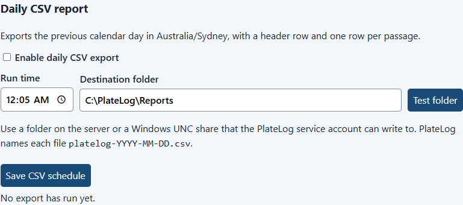

# PlateLog

PlateLog is a prototype for a local Axis licence plate register. The browser demo uses simulated captures to show vehicle photos, live plate search, date and time filters, Excel export with photos, and password-protected application settings. A persistent instance can receive Axis HTTP POST events into the same register. The [v1 specification](technical-spec.md) describes the wider pilot.


Typing `AO1` finds the corrected plate `DEMO-A01` by its original camera read.


One of the simulated camera captures features `L19MXB`, a nod to PlateLog’s creator.


## Quick start

With Python 3.12 or 3.13 installed, run the following from the repository root, then open `http://127.0.0.1:8765/`:

```sh
python -m pip install -r requirements.txt
python -m platelog preview
```

## Run the demo

From this directory, with Python 3.12 or newer:

```sh
python -m pip install -r requirements.txt
python -m platelog demo
```

The demo starts a temporary HTTP server on `127.0.0.1`, sends simulated camera payloads, and shuts down. It uses two fictitious cameras, generated JPEGs marked as synthetic, and a temporary SQLite database. It exits with an error if any expected outcome fails.

| Case | Expected result |
| --- | --- |
| JSON with an embedded JPEG | The saved JPEG matches the original bytes and SHA-256. |
| Replay of the same packet | The receiver returns the original packet and passage IDs. |
| Plate correction arrives after the closing event | The entry shows `DEMO-A01`, direction `in`, three packets, and the original photo. The initial OCR text `DEMO-AO1` remains searchable. |
| A second camera sends multipart metadata and a JPEG | The exit shows `DEMO-B02`, direction `out`, and its own photo, even though both cameras use runtime ID `42`. |
| Unauthenticated photo request and invalid payload | The server returns HTTP `401` and `400` respectively. |

The simulator follows the documented Axis push fields. The multipart fixture represents a JSON part and a separate JPEG. A real payload from the candidate firmware is still needed to confirm wire compatibility, camera authentication, buffering and the passage correlation window. [Axis push event API](https://developer.axis.com/vapix/applications/license-plate-verifier-api/#push-events)

## Keep a local demo running

Set `PLATELOG_DEMO_TOKEN` to the same randomly generated value of at least 24 URL-safe characters in both terminals. Start the server in the first terminal:

```sh
python -m platelog serve
```

Send and verify the synthetic sequence in the second terminal:

```sh
python -m platelog simulate
```

Use the returned passage ID to read its history. For example, in PowerShell:

```powershell
$headers = @{ Authorization = "Bearer $env:PLATELOG_DEMO_TOKEN" }
Invoke-RestMethod -Headers $headers 'http://127.0.0.1:8765/api/passages?camera=demo-entry'
```

The server binds to loopback and stores this mode’s data in `.platelog-data/` by default. The temporary `demo` command is the quickest way to get a fresh run. For the storage and parser regression tests, run `python -m unittest discover -s tests -v`.

## Open the browser preview

Run `python -m platelog preview --timezone Australia/Sydney`, then open `http://127.0.0.1:8765/`. Type part of a registration to filter the list as you type. Enter `AO1` to find the corrected entry by its original OCR read. Click its thumbnail or registration to open the original photo and packet history. Use the Columns controls to hide or show Make, Model or Colour. The browser remembers these settings.

The register shows 50 passages per page, newest first. Page 1 updates automatically every five seconds with the current filters. Use the page links to browse older results and **Return to live** to resume automatic updates. The header shows the server clock and when PlateLog last saved a camera read, across all cameras. The clock uses the register's display time zone and the read time updates even while browsing older pages.

**Vehicle activity** updates every five seconds and shows the last 24 hours in 15-minute intervals. Total passes counts each passage. Unique plates and unregistered vehicles count distinct plate numbers. The busiest hour shows the highest number of passes in any 60-minute span in the window. The camera dropdown applies to the chart. The chart retains its 24-hour window while you search or browse older passages. Register rows show **Registered** in black or **Unregistered** in red, with a matching photo border. Both the rows and the activity summary use the current registered list.

Set **From** and **To** to filter by the passage's first capture time in the displayed time zone. The selected **To** minute is included. Leave either bound blank to search without that limit. **Export Excel** downloads a summary with counts by camera and one row per matching passage across all pages, with a thumbnail before the registration. **Excel without photos** keeps the passage data and photo counts in a smaller workbook.

PlateLog prepares one Excel export at a time. Each workbook can include up to 10,000 passages. Exports with photos also have a limit of 5,000 thumbnails and 32 MiB of combined thumbnails. If a selection exceeds a limit, narrow **From** and **To** or switch to **Excel without photos** when offered. PlateLog returns a message in place of a partial workbook.

The browser preview uses a fresh database unless you specify `--data-dir`. The two JPEG fixtures are generated images of front-facing vehicles with fictitious plates. The simulator supplies make, model and colour. Missing fields appear as a dash. Axis documents colour in `vehicle_info`. Make and model require a source that supplies them. A Docker image can serve the same preview:

```sh
docker build -t platelog-preview .
docker run --rm --read-only --tmpfs /tmp:rw,noexec,nosuid,size=32m,mode=1777 -p 127.0.0.1:8765:8765 platelog-preview
```

For a LAN demo, publish `8765:8765` and pass `preview --host 0.0.0.0 --allowed-host SERVER_NAME` after the image name. Use the server hostname or IPv4 address in place of `SERVER_NAME`. Anyone who can reach the listener can view and export the sample register.

### Run Docker on an offline Linux server

On an internet-connected machine with Docker, build the image from this repository. Use the same CPU architecture as the destination server.

```sh
docker build -t platelog-preview:latest .
docker save -o platelog-preview.tar platelog-preview:latest
```

Transfer `platelog-preview.tar` to the offline Linux server using your approved file transfer process. With Docker already installed, run these commands from the folder containing the archive.

```sh
docker load -i platelog-preview.tar
docker run -d --name platelog --restart unless-stopped --pull=never \
  --read-only --tmpfs /tmp:rw,noexec,nosuid,size=32m,mode=1777 \
  -p 0.0.0.0:8765:8765 platelog-preview:latest \
  preview --host 0.0.0.0 --allowed-host '*'
```

From a desk that can reach TCP port `8765` on the server, open `http://SERVER-NAME:8765/` using the Linux server's hostname or IPv4 address. This setup recreates the synthetic register on restart.

For an empty, persistent instance with camera intake and Admin settings, load the same image archive and run the following on the Linux host. Use a separate container name or stop the temporary demo to free TCP `8765` first. The image runs as UID and GID `65532`.

```sh
sudo install -d -m 0750 -o 65532 -g 65532 "$PWD/platelog-data"
docker run -d --name platelog --restart unless-stopped --pull=never \
  --read-only --tmpfs /tmp:rw,noexec,nosuid,size=32m,mode=1777 \
  --mount "type=bind,source=$PWD/platelog-data,target=/data" \
  -p 0.0.0.0:8765:8765 -p 0.0.0.0:8766:8766 platelog-preview:latest \
  preview --host 0.0.0.0 --allowed-host '*' --data-dir /data --no-demo
```

Sign in to **Admin** on TCP `8765` with the initial password `admin`, then set a new password to unlock settings. Register each camera before sending events to TCP `8766`. For scheduled CSV reports, `/data` is writable by default with this setup. An additional destination can be mounted when creating the container.

## Admin

Under **Registered vehicles**, use **Download CSV template** for the required `Plate` heading. Upload a UTF-8 CSV or an `.xlsx` file with that heading on the first worksheet. Format the Excel column as Text before entering plates so leading zeros are preserved. **Preview import** shows additions, existing plates, duplicate rows, and any removals. Select **Add to existing list** to keep plates missing from the file, or **Replace entire list** to remove them. Apply the preview after reviewing the changes. Each file can contain up to 25,000 plate rows and be up to 4 MiB.

Use **Scheduled list refresh** to replace the list daily from a CSV with the same heading. Set the refresh time in the register's time zone and enter the full source file path on the server or a Windows UNC share. Give the PlateLog service account read access and have the source system publish the finished CSV before the scheduled time, for example by writing a temporary file and renaming it when complete. PlateLog attempts the refresh once per day. It can catch up after a restart on the same day. If the file is missing, unreadable, empty, or invalid, PlateLog keeps the current list and shows the failure alongside the last successful refresh in Admin.

Start the preview with a persistent directory:

```sh
python -m platelog preview --data-dir .platelog-data --timezone Australia/Sydney --manage-web-port
```

When no administrator password has been set, sign in with `admin`, enter a new password of at least 14 characters, then sign in with the new password. The initial sign-in only opens the password change form. To set your own password before opening the listener, run `python -m platelog admin-password --data-dir .platelog-data` first.

The register opens without sign-in by default. To require sign-in, sign in to **Admin**, set a separate staff password under **Register access**, and enable **Require staff sign-in to view the register**. Staff can use the register, search, passage details, photos and Excel exports. Only the administrator password opens both the register and **Admin**, including camera settings, retention, scheduled reports and service controls. Changing register access or rotating the staff password ends staff sessions. Upgrading removes any previously enabled staff access to Admin.

Under **Retention**, new installations start with automatic cleanup enabled and keep passages for 360 days and photos for 90 days. Existing installations keep their current cleanup setting, including the previous off default if nobody saved a preference. Cleanup runs at startup and hourly while enabled. **Purge now** asks for confirmation and applies the saved limits immediately, even when automatic cleanup is off. Purging a passage removes all of its event packets and photos. A passage expires based on its last capture, and a photo expires based on its own capture. Shorter photo retention can leave a passage searchable with an **Image expired** label. **Storage** shows passage, event and photo counts, and **Recent admin activity** records purges and settings changes.

Under **Daily CSV report**, enable the schedule, choose a time such as `00:05`, and enter an existing destination folder. **Test folder** checks the entered path from the PlateLog service by writing, reading back, and removing a temporary file. Use **Save CSV schedule** to apply your changes. PlateLog writes `platelog-YYYY-MM-DD.csv` for the previous calendar day in the register's time zone. It includes headers even on empty days. The rows reflect the passages still in the register when the report runs. If the folder is temporarily unavailable, PlateLog retries the previous day's export while it is still due and shows the result in Admin.



For a remote Windows share, use a UNC folder such as `\\fileserver\reports\PlateLog`. In Docker, mount the destination into the container and enter its path inside the container. [Microsoft guidance on services and redirected drives](https://learn.microsoft.com/en-us/windows/win32/services/services-and-redirected-drives)

Once signed in, use **Change administrator password** and enter the current password. Changing the password ends all Admin sessions. **Restart PlateLog** restarts the web server, keeps the data in the same directory, and returns Admin to sign-in.

**Admin → Display** changes the time zone used for the register, date and time filters, and Excel reports. On native installs with `--manage-web-port`, **Admin → Service** sets the staff web port and **Admin → Axis cameras** sets the dedicated camera POST port. They default to `8765` and `8766`. Allow a new TCP port in the firewall before applying it. Saving either port restarts PlateLog. When the camera port changes, update the POST destinations on the cameras. The staff web port passed at launch is the fallback if the saved staff port is occupied at startup. If the camera port is unavailable, the register and Admin can still start.

Admin and staff sign-in work over HTTP once their passwords are configured. To reach the preview from an approved private LAN, add `--host 0.0.0.0 --allowed-host YOUR_HOST` to the preview command. HTTP carries passwords and session cookies in clear text. To require HTTPS for both sign-ins, use `--require-https-admin --tls-cert CERT.pem --tls-key KEY.pem` with a certificate trusted by clients. The `admin-password` command resets the administrator password and invalidates administrator sessions.

For a native Windows Server preview with no Internet access, see the [offline bundle and Windows service setup](deploy/windows/README.md).

## Run the HTTPS pilot from Python source

Use the `pilot` command for a persistent register over HTTPS. On Windows, the tested offline runtime is CPython 3.15.2 x64 with SQLite 3.53.4. Check the SQLite version bundled with the interpreter before accepting live data. Install the pinned dependencies in a virtual environment. For offline use, transfer the source, a reviewed wheelhouse for the target Python and Windows architecture, and its hash-locked requirements. [SQLite WAL advisory](https://sqlite.org/wal.html#the_wal_reset_bug)

1. Give the server an internal DNS name and create its DNS record. Obtain a Server Authentication certificate with that DNS name in its Subject Alternative Name from a CA approved by the site. Prepare `server.pem` with the leaf followed by any required intermediates and keep the matching `server-key.pem` readable by the runtime account. Distribute the public CA certificate through the site's managed trust process if workstations do not already trust it. [Microsoft certificate deployment](https://learn.microsoft.com/en-us/windows-server/identity/ad-fs/deployment/distribute-certificates-group-policy)
2. Set the pilot Administrator password and start PlateLog from the source folder. Use your approved DNS name, certificate paths, and data folder in place of the examples.

   ```powershell
   python -E -s -B -m platelog admin-password --data-dir C:\ProgramData\PlateLog\data
   python -E -s -B -m platelog pilot --data-dir C:\ProgramData\PlateLog\data `
       --allowed-host platelog.example.internal --tls-cert C:\PlateLog\tls\server.pem `
       --tls-key C:\PlateLog\tls\server-key.pem
   ```

3. Allow staff HTTPS from approved networks on TCP 443. Change the port with `--port` if needed. On a fresh pilot register, staff sign-in starts required. Open `/admin` over HTTPS and set a staff password in **Register access**. Use your approved Windows process supervisor to start the pilot with the same arguments and runtime identity.
4. When ready for camera inputs, add `--camera-transport https --camera-port 8766` to the launch command. Allow this port only from approved cameras. In **Admin → Axis cameras**, set a distinct credential for each camera and point it to `https://<name>:8766/api/axis/<id>/events`. Confirm certificate trust and run a controlled test on the real camera.

For a standalone Windows workstation where IT approves a manual import, use the public DER `.cer` file and SHA-256 fingerprint supplied through a trusted IT channel. The script checks the exact certificate and adds it to the current user's trust store. Add `-WhatIf` to preview the import. For managed staff PCs use the site's central certificate deployment. [Windows certificate stores](https://learn.microsoft.com/en-us/windows-server/identity/ad-cs/inspect-certificates-manage-certificate-stores)

```powershell
.\examples\Trust-PlateLogCertificate.ps1 `
    -CertificatePath 'C:\IT\platelog-ca.cer' -ExpectedSha256 '<64-character SHA-256 from IT>'
```

Open `https://<name>/` on a staff workstation and check that the browser loads the sign-in page with normal certificate validation.

### Configure Axis HTTP POST

Use a persistent `--data-dir` to enable the camera listener. Starting with `--no-demo` and a fresh data directory gives you an empty register for a trial. In **Admin → Axis cameras**, add a camera ID such as `entry`. Select **HTTP Basic** and set a username and password, or select **No credentials** for a network where IT restricts access to the camera. Camera POSTs are accepted once a camera is configured and enabled. Camera settings apply when saved.

In AXIS License Plate Verifier, open **Integration → Push events**, select **HTTP POST**, and enter the camera listener address and path. For `entry` on the default port, use `http://SERVER-NAME:8766/api/axis/entry/events`. If you selected Basic, enter the same username and password on the camera. Use the camera's **Test** button and check that the test plate appears on the register. PlateLog accepts JSON and multipart from configured cameras. Verify the target firmware with a controlled pass before accepting a live deployment. [Axis push event setup](https://help.axis.com/en-us/axis-license-plate-verifier#push-event-information-to-third-party-software) · [Axis push event API](https://developer.axis.com/vapix/applications/license-plate-verifier-api/#push-events)

To test a configured receiver from PowerShell, send the `L19MXB` demo as an Axis Q1700-LE `new` event. The example follows a captured HTTP JSON request and uses synthetic camera details and a JPEG in `ImageArray[].BinaryImage`.

```powershell
.\examples\Send-AxisEvent.ps1 -Uri http://127.0.0.1:8766/api/axis/entry/events
```

For HTTP Basic, append `-Credential (Get-Credential)` and enter the camera credential from **Admin → Axis cameras**. To replay a captured request body byte for byte, add `-CapturePath .\axis-capture.json`. For a raw multipart capture, pass its original `-ContentType` including the boundary.

For a persistent Docker instance, publish the staff and camera ports separately, for example `-p 8765:8765 -p 8766:8766`. To use a different camera port on the host, change the first number in the camera mapping. Keep `--manage-web-port` off in Docker so its internal ports stay aligned with the published mappings.

## Suggested workplace trial

Review the register and export with the supplied synthetic captures. The demo runs without access to the camera network. If the workflow fits, arrange a controlled vehicle pass with one Axis camera and the site's agreed access and retention settings.

## License

PlateLog is available under the [MIT License](LICENSE).
